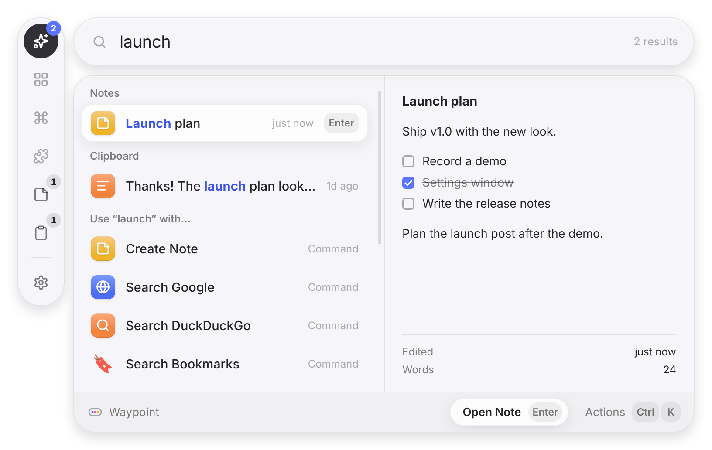
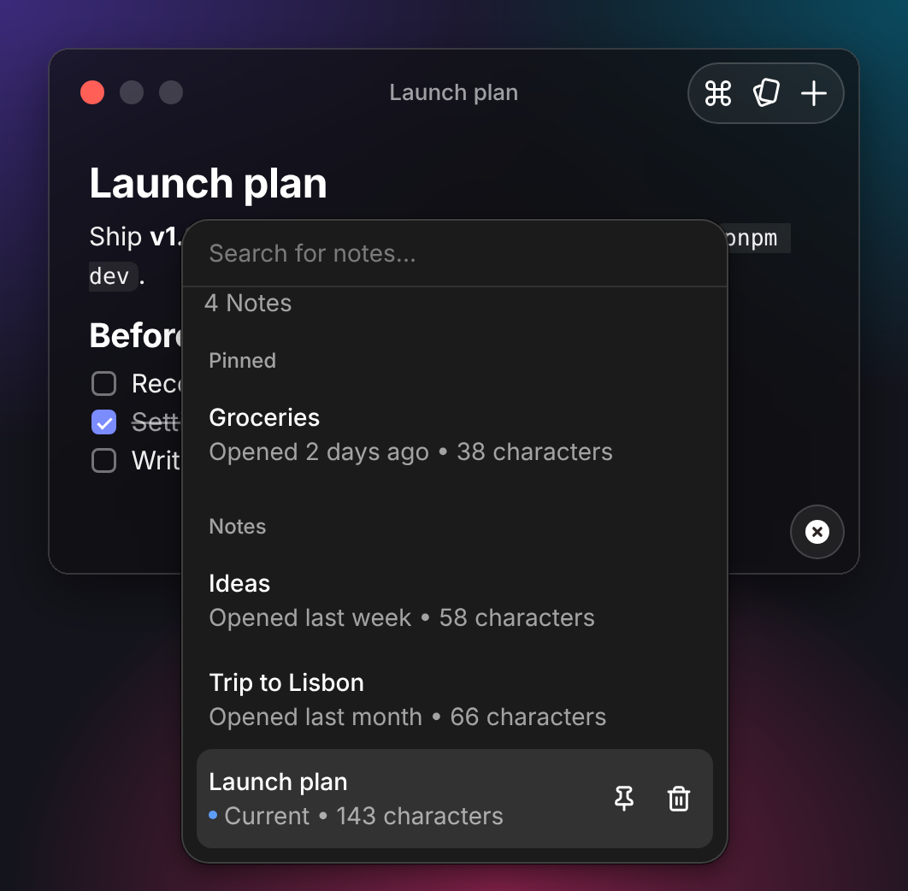

# Waypoint

[](https://github.com/alexsilver8/waypoint/actions/workflows/ci.yml)
[](https://github.com/alexsilver8/waypoint/releases)
[](./LICENSE)
[](https://www.conventionalcommits.org)

An open-source, keyboard-first launcher for macOS, Windows and Linux, in the spirit of Raycast. Press <kbd>⌥</kbd> <kbd>Space</kbd>, type a few letters, press <kbd>↵</kbd>.

Website: [waypoint.alexsilver.dev](https://waypoint.alexsilver.dev/)



## What it does

- **Finds everything from one box** — apps, commands, notes and what you copied all show up as you type. <kbd>⇥</kbd>, or the icons down the left of the window, narrow the list to Apps, Commands, Notes or Clipboard, or to **Extensions**, which lists every extension with its commands so you can pick one without remembering its name. A preview beside the results shows the note, copied text or image you've selected.
- **Opens apps** — finds installed applications on every platform.
- **Keeps notes, as many as you want** — a floating Notes window that works like Raycast Notes: one note at a time in a small window that grows as you write, **Browse Notes** (<kbd>⌘</kbd> <kbd>P</kbd>), an action panel (<kbd>⌘</kbd> <kbd>K</kbd>), pinned notes, back and forward, find and replace, and Recently Deleted. Every note is a plain Markdown file, so you can sync, back up or edit them with anything. There's no limit on how many you keep.
- **Calculates as you type** — `1200 * 1.077 + 2^5` shows `1,324.4`, and percentages work the way you'd say them: `15% of 80`, `20% off 80`, `80 + 15%`, `80 - 20%`. <kbd>↵</kbd> copies the answer.
- **Converts units and currencies** — `5 km to mi` shows `3.11 mi`, and `72 f in c`, `3 ft 4 in to cm`, `1.5 gb in mb`, `90 min to h` and `2 cups to ml` work too: length, weight, volume, temperature, time, data, speed and area, by name, plural or symbol. `100 usd in eur` and `€50 to gbp` use the European Central Bank's rates, fetched once a day and kept for when you're offline; the answer says which day they're from. <kbd>↵</kbd> copies the number.
- **Remembers your clipboard** — searchable history of copied text and images, skipping anything password managers mark as private. Images are kept as files on your computer; <kbd>↵</kbd> copies one back and <kbd>⌘</kbd> <kbd>↵</kbd> pastes it.
- **Tells the time elsewhere** — `time in tokyo` shows the time there now, with the day and how far ahead of you it is; `3pm in tokyo`, `15:00 london in new york` and `9am pst to cet` move a time from one place to another. Cities, countries and the usual abbreviations (UTC, PST, CET…) work, and daylight saving is taken care of. <kbd>↵</kbd> copies the time.
- **Quicklinks and snippets** — save a link (a website, a file or folder, a place in an app) or some text you paste often, and open or paste it with a few keys: `gh waypoint` searches GitHub for “waypoint”, `!sig` pastes your signature. See [Quicklinks and snippets](#quicklinks-and-snippets).
- **Searches the web** — anything that doesn't match falls back to Google, DuckDuckGo or any extension that offers itself.
- **Learns what you use** — frequently used items rise to the top.
- **Snaps windows** — halves, thirds, quarters, sixths, maximize, centre, larger or smaller, and the next display for the window you were using, and **Restore** to put it back. See [Windows](#windows).
- **Runs your computer** — lock, sleep, restart, shut down, log out, empty the Trash, eject disks and turn Wi-Fi on or off, with a check before anything you can't undo. See [System](#system).
- **Comes with extensions** — file search, your downloads and browser bookmarks, what's taking up space on your disk, your own scripts and Shortcuts, Keep Awake, translation and a dictionary, developer tools like Port Manager, Docker and GitHub, plus Media Controls and System Info, described [below](#included-extensions).
- **Runs extensions** — commands written in JavaScript, each extension in a separate process. They show lists, pages of Markdown and forms. Find other people's with **Browse Extensions**, or install them from npm or GitHub with **Install Extension** (see [Installing extensions](#installing-extensions)), or write your own (see [Writing extensions](docs/extensions.md)).
- **Everything has actions** — <kbd>⌘</kbd> <kbd>K</kbd> lists what you can do with the selected item.
- **Gives any command its own shortcut** — press it anywhere to snap a window, search your files or keep your computer awake, without opening the launcher first. See [Command shortcuts](#command-shortcuts).
- **Looks at home on your desktop** — the launcher is three panes floating on your desktop with nothing around them: the scope dock, the search field, and the results with their preview and action bar. Light or dark, in a [colour theme](#colour-themes) of your choice. Drag it anywhere that isn't a control to move it: like Raycast, guide lines show the screen's center, its middle and where the launcher opens, and it snaps to them. It opens again where you left it on that display. Settings floats the same way on macOS. The Notes window is liquid glass that blurs what's behind them on macOS and Windows 11; Linux gets the same design on a solid background, since it has no system blur.

## Install

Download the latest build for your system from [Releases](https://github.com/alexsilver8/waypoint/releases).

Builds aren't code-signed yet, so your system will warn you the first time you open one. On Windows, choose **More info → Run anyway**.

**On macOS, run Waypoint from source for now.** The Mac build isn't signed with an Apple Developer ID, so macOS doesn't let it run properly. Until it is, clone the repository and start it with `pnpm dev` (you need Node.js 22.12 or later, and `corepack enable` for pnpm):

```sh
git clone https://github.com/alexsilver8/waypoint.git
cd waypoint
pnpm install
pnpm dev
```

Run from source, Waypoint doesn't update itself: `git pull`, then `pnpm install` and `pnpm dev` again, to get the latest version.

Waypoint keeps itself up to date from these releases. On Windows and from the AppImage, a new version downloads in the background and installs when you restart Waypoint: choose **Restart to Update** in the tray menu or the notification, or just quit. macOS only installs updates to apps signed with an Apple Developer ID, which Waypoint isn't yet, and a `.deb` belongs to your package manager, so there Waypoint tells you a new version is out and **Download Waypoint …** opens its release. It looks a little after it starts and every six hours; **Check for Updates…** in the tray menu or **Settings → About** looks right away, and **Check for updates** in **Settings → General** turns the automatic check off.

The first time it starts, Waypoint opens a short setup in place of the launcher: pick the shortcut that opens it (and try it right there), allow Accessibility on macOS so it can paste into other apps and move their windows, choose light or dark, and decide whether to keep clipboard history and open at login. <kbd>↵</kbd> moves on and <kbd>Esc</kbd> goes back. Pressing your shortcut on the last step opens the launcher. If you quit halfway it opens again next time; once you finish or skip it, it doesn't. Run **Set Up Waypoint**, or **Run Setup Again** under **Settings → About**, to go through it again.

## Use

| Keys | |
| --- | --- |
| <kbd>⌥</kbd> <kbd>Space</kbd> (<kbd>Alt</kbd> <kbd>Space</kbd>) | Open or close the launcher |
| <kbd>↑</kbd> <kbd>↓</kbd> | Move through results (also <kbd>Ctrl</kbd> <kbd>N</kbd> / <kbd>Ctrl</kbd> <kbd>P</kbd>) |
| <kbd>⇥</kbd> / <kbd>⇧</kbd> <kbd>⇥</kbd> | Switch between All, Apps, Commands, Extensions, Notes and Clipboard |
| <kbd>↵</kbd> | Run the primary action |
| <kbd>⌘</kbd> <kbd>↵</kbd> | Run the secondary action |
| <kbd>⌘</kbd> <kbd>1</kbd> … <kbd>9</kbd> | Run one of the first nine results in view (hold <kbd>⌘</kbd> to see the numbers; they follow the scroll) |
| <kbd>⌘</kbd> <kbd>K</kbd> | Show all actions |
| <kbd>Esc</kbd> | Go home to an empty search in All, from wherever you are; press it again to close |
| <kbd>⌫</kbd> | Go back one step, when nothing is typed or on a page of text (so does the arrow before the search field) |
| <kbd>⌘</kbd> <kbd>[</kbd> | Go back one step from anywhere, even while you type in a form |
| <kbd>⌘</kbd> <kbd>,</kbd> | Open settings (the gear at the bottom of the dock shows it while you hold <kbd>⌘</kbd> or point at it) |
| A command's own shortcut | Run that command from anywhere; see [Command shortcuts](#command-shortcuts) |

On a page of text that a command shows, <kbd>↑</kbd> <kbd>↓</kbd>, <kbd>Page Up</kbd> <kbd>Page Down</kbd> and <kbd>Space</kbd> scroll it, and you can select its text with the pointer and copy it with <kbd>⌘</kbd> <kbd>C</kbd>. In a form, <kbd>⇥</kbd> moves between the fields and <kbd>⌘</kbd> <kbd>↵</kbd> submits it; <kbd>⌫</kbd> and the arrows stay with the field you're typing in, so <kbd>⌘</kbd> <kbd>[</kbd> goes back.

The Notes window has its own shortcuts, listed in the [Notes](#notes) section.

On Windows and Linux, use <kbd>Ctrl</kbd> wherever you see <kbd>⌘</kbd>.

On Linux under Wayland, global shortcuts may not reach the app. Bind a shortcut in your desktop settings to run `waypoint` instead: launching it again opens the running instance. To bind one command, run `waypoint --command <extension>/<command>`, like `waypoint --command keep-awake/toggle`; Settings → Extensions shows each command's name under it. A `waypoint://commands/<extension>/<command>` link opens one from anywhere that opens links; since any web page can open a link, one that would run something straight away waits for <kbd>↵</kbd> in the launcher.

### Command shortcuts

Any command can have a global shortcut of its own, built in or from an extension: **Left Half**, **Search Files**, **Toggle Keep Awake**. Pick a command in the launcher and choose **Set Shortcut…** from <kbd>⌘</kbd> <kbd>K</kbd>, or find it under **Command shortcuts** in **Settings → Extensions**, then press the keys you want. The × beside a shortcut removes it.

Pressing it runs the command as if you'd picked it in the launcher, so it rises in your results too. A command that shows a list, like **Search Files**, opens the launcher at that list, and pressing its shortcut again closes it. Any other command just runs: **Left Half** moves the window you're in, and what a command has to say, like **Toggle Keep Awake** telling you how long it'll keep your computer awake, comes as a notification. If it fails, the launcher opens to say why. On macOS they follow what **System Settings → Notifications → Waypoint** allows; on Linux they need your desktop's notification service, which GNOME, KDE and most others run. Where there are none, the launcher opens with the message instead.

A shortcut a command can't use, because the launcher or another command has it or another app took it first, isn't lost quietly: the launcher says so, and Settings shows why beside it. While you record a shortcut, the others are paused, so pressing one records it rather than running it. The launcher's shortcut and the commands' show beside them in the results and at the top of <kbd>⌘</kbd> <kbd>K</kbd>.

### Command aliases

A command can also have an alias: a short word to type in the launcher, like `lh` for **Left Half**. Choose **Set Alias…** from <kbd>⌘</kbd> <kbd>K</kbd>, or type one beside the command under **Command shortcuts** in **Settings → Extensions**, and press <kbd>↵</kbd>. Empty the field or press the × to remove it.

Typing the whole alias puts its command first, above anything else that matches; typing the start of one ranks it high too. The alias shows beside the command in the results. Aliases are one word, without spaces, and case doesn't matter, so `LH` is `lh`. Each belongs to one command: if another command has it, Settings says which and leaves both as they were.

An alias comes before a snippet's keyword or a quicklink's name, since you gave it to that command on purpose: with `!sig` as an alias, typing `!sig` puts the command above the snippet, which is still the next result. Anything typed after it, like `gh waypoint`, still goes to a quicklink, and snippets still expand as you type in other apps.

## Notes



Run **Create Note** to start writing, or **Open Notes** to bring the window back. Notes show up in the launcher's search as you type, matching anything in them, not just the title; press <kbd>⇥</kbd> to see only notes, newest first, with a preview of the one you've selected. **Search Notes** lists them all on their own. **Create Note** also appears under **Use “…” with** for anything you type, so you can type a thought into the launcher and save it straight away.

The Notes window works like Raycast Notes. It shows one note at a time, floats above your other windows, and grows as the note gets longer, then shrinks back; the first line is the note's title, in the middle of the title bar. The three buttons at the top right are **Actions** (<kbd>⌘</kbd> <kbd>K</kbd>), **Browse Notes** (<kbd>⌘</kbd> <kbd>P</kbd>) and **New Note** (<kbd>⌘</kbd> <kbd>N</kbd>). **Browse Notes** lists every note with when you last had it open and how long it is, pinned notes first; the selected note has buttons to pin and delete it. Like Raycast's, popovers are a window of their own, so a short note's window doesn't grow to fit them: they hang below it. <kbd>Esc</kbd> closes a popover, then the window. At the foot of the window is how long the note is; click it to count words instead of characters.

| Keys | |
| --- | --- |
| <kbd>⌘</kbd> <kbd>K</kbd> | Show every action, with its shortcut |
| <kbd>⌘</kbd> <kbd>P</kbd> | Browse Notes |
| <kbd>⌘</kbd> <kbd>N</kbd>, <kbd>⌘</kbd> <kbd>D</kbd> | New note, duplicate the note |
| <kbd>⌘</kbd> <kbd>[</kbd>, <kbd>⌘</kbd> <kbd>]</kbd> | Go back and forward between the notes you've opened |
| <kbd>⌘</kbd> <kbd>⇧</kbd> <kbd>P</kbd> | Pin or unpin the note; <kbd>⌘</kbd> <kbd>1</kbd>–<kbd>9</kbd> open the first nine pinned notes |
| <kbd>⌘</kbd> <kbd>F</kbd> | Find and replace in the note (<kbd>↵</kbd> next, <kbd>⇧</kbd> <kbd>↵</kbd> previous) |
| <kbd>⌘</kbd> <kbd>⇧</kbd> <kbd>C</kbd> | Copy the note, or the selected text, as Markdown, HTML or plain text |
| <kbd>⌘</kbd> <kbd>⇧</kbd> <kbd>D</kbd> | Copy a `waypoint://` link that opens the note from anywhere |
| <kbd>⌘</kbd> <kbd>⇧</kbd> <kbd>E</kbd> | Export the note as Markdown, HTML or plain text |
| <kbd>⌘</kbd> <kbd>⌥</kbd> <kbd>,</kbd> | Show or hide the format bar, like the round **T** button at the bottom right |
| <kbd>⌘</kbd> <kbd>⇧</kbd> <kbd>/</kbd> | Turn window auto-resizing off or on |
| <kbd>⌘</kbd> <kbd>=</kbd>, <kbd>⌘</kbd> <kbd>-</kbd>, <kbd>⌘</kbd> <kbd>0</kbd> | Make the text bigger, smaller, or its usual size |
| <kbd>⌃</kbd> <kbd>X</kbd> (<kbd>Ctrl</kbd> <kbd>Shift</kbd> <kbd>Backspace</kbd>) | Delete the note; <kbd>⌃</kbd> <kbd>⇧</kbd> <kbd>X</kbd> deletes them all, after asking |

The action panel also turns **Always on Top** off and on, shows the note in Finder, and opens **Recently Deleted**: deleted notes wait there for 60 days, so you can bring one back with <kbd>↵</kbd>, then go to the system Trash.

### Formatting

Markdown you type turns into formatting as you go: `# ` starts a heading, `- ` a list, `[ ] ` a checklist, `> ` a quote and ` ``` ` a code block. Typing `/` at the start of a line (or after a space) opens a menu of the same, and a colon with a couple of letters, like `:tada`, picks an emoji. **Format...** in the action panel and the format bar format the selection or the line you're on. As in Raycast, the round **T** button at the bottom right (or <kbd>⌘</kbd> <kbd>⌥</kbd> <kbd>,</kbd>) shows the format bar in place of the note's length, and **×** hides it again: **Heading** and text style (bold, italic, strikethrough) menus, **Link**, **Inline Code**, **Code Block**, **Quote** and a **List** menu.

| Keys | |
| --- | --- |
| <kbd>⌘</kbd> <kbd>⌥</kbd> <kbd>1</kbd>–<kbd>3</kbd>, <kbd>⌘</kbd> <kbd>⌥</kbd> <kbd>0</kbd> | Heading 1–3, back to text |
| <kbd>⌘</kbd> <kbd>B</kbd>, <kbd>⌘</kbd> <kbd>I</kbd>, <kbd>⌘</kbd> <kbd>⇧</kbd> <kbd>S</kbd> | Bold, italic, strikethrough |
| <kbd>⌘</kbd> <kbd>L</kbd> | Add or edit a link; <kbd>⌘</kbd>-click a link to open it |
| <kbd>⌘</kbd> <kbd>E</kbd>, <kbd>⌘</kbd> <kbd>⌥</kbd> <kbd>C</kbd> | Inline code, code block |
| <kbd>⌘</kbd> <kbd>⇧</kbd> <kbd>B</kbd> | Quote |
| <kbd>⌘</kbd> <kbd>⇧</kbd> <kbd>8</kbd>, <kbd>7</kbd>, <kbd>9</kbd> | Bulleted list, numbered list, checklist |
| <kbd>⌘</kbd> <kbd>↵</kbd> | Tick or untick the checklist item you're on |

Notes are saved as you type, one `.md` file per note, and what you see is what's in the file: the formatting is Markdown, so it reads the same in any editor. A note is only rewritten when you change it, and then in a tidy form (for example `*` bullets become `-`). Notes with Markdown the editor can't show yet, like tables, images or front matter, open as plain Markdown instead, so nothing in them is lost. Set `notesDirectory` to a synced folder (Dropbox, iCloud Drive, a git repo) to have them everywhere; Markdown files already in that folder show up as notes too. Recently Deleted is the hidden `.deleted` folder inside it.

## Quicklinks and snippets

**Quicklinks** open a website, a file or folder, or a place in an app with a few keys. **Snippets** are text you paste often, like an address or a reply. Make them with **Create Quicklink** and **Create Snippet**, which open a form in the launcher: fill it in and press <kbd>⌘</kbd> <kbd>↵</kbd> (<kbd>Ctrl</kbd> <kbd>Enter</kbd> on Windows and Linux), and you're back at the search, ready to try it. A web address typed in the search can become one too: **Create Quicklink** in its <kbd>⌘</kbd> <kbd>K</kbd> starts the form with the link filled in. If something can't be saved, like a link Waypoint can't open or a keyword another snippet has, the form says why and keeps what you typed. **Settings → Quicklinks** and **Settings → Snippets** make and change them too.

Both show up in the launcher's search as you type: a quicklink by its name, a snippet by its name or its keyword, like `!sig`. Snippets only show once you've typed something, so they don't crowd the list of commands. <kbd>⌘</kbd> <kbd>E</kbd> on one in the search edits it in the same form.

A quicklink's link is a web address (`https://github.com`, or just `github.com`), a path (`~/Downloads`, `C:\Projects`), or an app's own link (`spotify:`, `obsidian://open?vault=Notes`). Pick an app under **Open With** to open it there rather than in the usual one: Waypoint uses `open -a` on macOS, `Start-Process` on Windows, and `gio launch` (or the app's own command) on Linux.

Put `{argument}` in a link to fill it in as you go. Type the quicklink's name, or its first letters or initials, then the text: with a quicklink called GitHub Search that links to `https://github.com/search?q={argument}`, `gh waypoint` ↵ opens the search for “waypoint”. Picking one with nothing typed after its name types the name for you, so you only add the rest. Quicklinks with `{argument}` are also offered under **Use “…” with** for anything you type.

**Search Quicklinks** and **Search Snippets** list them all, with a preview filled in:

| Keys | Search Quicklinks | Search Snippets |
| --- | --- | --- |
| <kbd>↵</kbd> | Open it | Paste it into the app you were in |
| <kbd>⌘</kbd> <kbd>↵</kbd> | Copy the link | Copy it |
| <kbd>⌘</kbd> <kbd>E</kbd> | Edit it | Edit it |
| <kbd>⌘</kbd> <kbd>⌫</kbd> | Delete it | Delete it |

Saving an edit goes back to the list with the change in it. **Edit in Settings** in <kbd>⌘</kbd> <kbd>K</kbd> opens it in Settings instead. A snippet picked in the launcher's search pastes too. Pasting works as it does for emoji, so with **Paste into the app you were in** turned off, <kbd>↵</kbd> copies instead.

| Placeholder | |
| --- | --- |
| `{argument}` | Quicklinks only: what you type after the name. `{argument default="news"}` is used when nothing is typed, and `{argument name="term"}` gives it a name. |
| `{clipboard}` | The text you copied last. |
| `{date}`, `{time}`, `{datetime}` | Now, written the way your system writes dates and times. `format="yyyy-MM-dd HH:mm"` writes it your way: `yyyy` `yy` years, `MMMM` `MMM` `MM` `M` months, `dd` `d` days, `EEEE` `EEE` weekdays, `HH` `H` `hh` `h` hours, `mm` minutes, `ss` seconds, `a` AM or PM, and words in single quotes as they are. `offset="+1d"` moves it, in `y` years, `M` months, `w` weeks, `d` days, `h` hours or `m` minutes, like `-2w` or `+1M -3h`. An offset Waypoint can't use, like `tomorrow` or `+300000y`, leaves the placeholder as you wrote it, so the mistake shows in the preview. |
| `{uuid}` | A new random ID each time. |

In a link that's a web address or an app's link, what goes in is percent-encoded, so `cats & dogs` arrives as `cats%20%26%20dogs`; in a path it goes in as it is. Anything else in braces stays as it is, so JSON in a snippet comes out intact. A link that starts with a placeholder, like `{clipboard}` on its own, only opens web addresses, so text copied from anywhere can't open a file, a program or another app's link.

Quicklinks and snippets are kept in `quicklinks.json` and `snippets.json` in Waypoint's data folder, and changes you save there show up right away. One Waypoint can't use, like a quicklink without a link, is left out with a warning in the log, and the rest still load. It stays in the file, where it was, when Waypoint saves a change, so you can fix it. While a file isn't valid JSON, changes from the launcher and Settings are refused with a message, rather than written over it:

```json
[
  { "name": "GitHub Search", "link": "https://github.com/search?q={argument}", "icon": "🐙" },
  { "name": "Plans", "link": "~/Documents/plans.md", "openWith": "Visual Studio Code" }
]
```

### Expanding as you type

Turn on **Expand keywords as you type** in Settings → Snippets, and typing a snippet's keyword in any app replaces it with the snippet: Waypoint erases the keyword, pastes the snippet, and puts your clipboard back as it was. A keyword that starts with a letter or digit, like `sig`, expands only at the start of a word, so it doesn't fire inside "design"; one that starts with punctuation, like `!sig` or `;sig`, expands wherever you type it. In Waypoint's own windows keywords don't expand, so the launcher can still find a snippet by its keyword.

- It's off until you turn it on, and until then nothing watches the keyboard.
- macOS asks for Accessibility, which lets Waypoint see keys typed in other apps and press Backspace and ⌘V.
- On Linux it works in X11 sessions; Wayland doesn't let one app see the keys typed in another.
- Keys are read by where they sit on a US keyboard. On another layout, like AZERTY or Dvorak, a keyword expands when you press the keys a US keyboard types it with, which may not be the ones that type it on yours.

## Windows

Type a layout and press <kbd>↵</kbd>: the launcher steps aside and the window you were using moves. Give the ones you use a [shortcut of their own](#command-shortcuts) to move the window you're in without opening the launcher at all.

| Command | |
| --- | --- |
| **Left Half**, **Right Half**, **Top Half**, **Bottom Half**, **Center Half** | Half the screen; Center Half is the middle half, across a wide screen and down a tall one |
| **Top Left Quarter**, **Top Right Quarter**, **Bottom Left Quarter**, **Bottom Right Quarter** | A quarter |
| **First Third**, **Center Third**, **Last Third**, **First Two Thirds**, **Center Two Thirds**, **Last Two Thirds** | Thirds, side by side on a wide screen and stacked on a tall one |
| **Top Left Sixth**, **Top Center Sixth**, **Top Right Sixth**, **Bottom Left Sixth**, **Bottom Center Sixth**, **Bottom Right Sixth** | Sixths: three across and two down on a wide screen, two across and three down on a tall one, where the centre sixths take the middle row |
| **Maximize**, **Almost Maximize**, **Center** | Fill the screen, nine-tenths of it, or keep the size and centre it |
| **Make Larger**, **Make Smaller** | Grow or shrink the window by a tenth of the screen around its centre, keeping it on the screen; Make Smaller stops at a fifth of the screen |
| **Next Display**, **Previous Display** | The same place on another screen, scaled to fit |
| **Restore** | Back where the window was before Waypoint first moved it |

Windows fill the screen without the menu bar, Dock or taskbar. They're moved with System Events on macOS, which needs Waypoint allowed under **System Settings → Privacy & Security → Accessibility** (as pasting does), with Windows' own window calls on Windows, and with `xdotool` on Linux. Linux needs an X11 session: Wayland doesn't let one app move another's windows.

## System

| Command | |
| --- | --- |
| **Lock Screen**, **Sleep** | Right away (Sleep on macOS and Linux) |
| **Restart**, **Shut Down**, **Log Out** | Asks first; open apps are asked to quit, so they can save |
| **Empty Trash** (**Empty Recycle Bin** on Windows) | Asks first |
| **Eject Disks** | USB drives, SD cards, disk images and network shares. <kbd>↵</kbd> ejects one; **Eject All** ejects them all |
| **Toggle Wi-Fi** | Turns Wi-Fi off if it's on, and on if it's off |
| **Toggle System Appearance** | Switches macOS between light and dark |

On macOS, Empty Trash asks once to control Finder, and Restart, Shut Down and Log Out to control System Events. On Linux, Restart, Shut Down and Log Out go through GNOME, KDE, Xfce or Cinnamon, so apps can ask to save; on other desktops Restart and Shut Down use systemd, which closes apps without asking (the confirmation says so), and Log Out isn't available. Wi-Fi uses NetworkManager (`nmcli`) or `rfkill`, and ejecting uses `udisksctl`.

## Included extensions

These come with Waypoint and are written with the same [extension API](docs/extensions.md) as any other, in [`extensions/`](extensions).

| Command | |
| --- | --- |
| **Search Files** | Files and folders by name, from Spotlight on macOS, [Everything](https://www.voidtools.com) (with its `es` command-line tool) or Windows Search on Windows, and `locate` or `fd` on Linux; without those, your home folder is looked through. With nothing typed, the files you opened recently. The preview shows the start of a text file, or what a folder holds. <kbd>↵</kbd> opens it, <kbd>⌘</kbd> <kbd>↵</kbd> shows it in Finder or Explorer, <kbd>⌘</kbd> <kbd>Y</kbd> is Quick Look on macOS, **Copy File** puts the file itself on the clipboard to paste into a chat or a folder, and <kbd>⌘</kbd> <kbd>⇧</kbd> <kbd>⌫</kbd> moves it to the Trash. Also from **Use “…” with**. |
| **Search Downloads**, **Open Latest Download** | Your Downloads folder, newest first, with anything still downloading, and the newest one opened in one go. |
| **Disk Usage**, **Largest Files**, **Archives and Installers** | What's taking up space. **Disk Usage** lists your home folder biggest first, and <kbd>↵</kbd> opens a folder to look inside; type a folder (`~/Library`, `/Volumes/Backup`) to look there instead. **Largest Files** lists the biggest files anywhere in it, filtered by name, folder or kind (`zip`, `video`), and **Archives and Installers** the zips, disk images and installers you may not need any more, saying which look unpacked already. Sizes are the space files take on disk, as `du` counts them. The scan carries on in the background, so the lists fill in as it goes and open at once afterwards; <kbd>⌘</kbd> <kbd>R</kbd> scans again, and <kbd>⌘</kbd> <kbd>⇧</kbd> <kbd>⌫</kbd> moves something to the Trash. Cloud storage (Google Drive, OneDrive, Dropbox on macOS) and other disks are counted when you open them. On macOS the first scan asks to look in Desktop, Documents and Downloads; with Full Disk Access it counts the folders macOS keeps private too, like Mail and Messages. |
| **Search Bookmarks** | The bookmarks in Chrome, Brave, Edge, Vivaldi and Chromium, in every profile, the ones you opened last first. <kbd>↵</kbd> opens one in the browser and profile it's from, <kbd>⌘</kbd> <kbd>↵</kbd> in your default browser. Read from the browsers' own files; nothing is sent anywhere. Also from **Use “…” with**. |
| **Search Script Commands**, **Create Script Command** | Your own scripts, run from the launcher; Raycast's script commands work too. See [Script commands](#script-commands). |
| **Run Shortcut** | Your Shortcuts, the ones you ran last first, so anything Shortcuts can do (turning on a Focus, say) is a few keys away. <kbd>⌘</kbd> <kbd>↵</kbd> opens one in Shortcuts to edit. macOS 12 and later. |
| **Keep Awake**, **Toggle Keep Awake**, **Allow Sleep** | Keeps your computer and its display awake for a while (`45m`, `1h30`), until a time (`5pm`), or until you turn it off. On macOS it runs `caffeinate` and on Linux `gnome-session-inhibit` or `systemd-inhibit`, which carry on if Waypoint restarts; on Windows Waypoint keeps it awake itself, while it's running. |
| **Translate** | [DeepL](https://www.deepl.com), into your language, or into a second language you pick for text that's already in yours. Paste a DeepL API key into its search field once; it's kept in Waypoint's data folder (`extension-data/deepl`). Also from **Use “…” with**. |
| **Define Word** | English definitions, examples and synonyms from Wiktionary, through the [Free Dictionary API](https://dictionaryapi.dev). Also from **Use “…” with**. |
| **Open Ports** | Every program listening on a port, with its command line and whether other devices can reach it. <kbd>↵</kbd> stops it, <kbd>⌘</kbd> <kbd>⇧</kbd> <kbd>⌫</kbd> forces it, <kbd>⌘</kbd> <kbd>O</kbd> opens it in the browser. |
| **Search Gitmoji** | The [gitmoji](https://gitmoji.dev) list by name or meaning. <kbd>↵</kbd> pastes the emoji, <kbd>⌘</kbd> <kbd>⇧</kbd> <kbd>C</kbd> copies its `:code:`. Recently used come first. |
| **Search Emoji** | Every emoji in a grid, by name, keyword or `:shortcode:`, recently used first. The arrow keys move in every direction. <kbd>⌘</kbd> <kbd>⇧</kbd> <kbd>T</kbd> picks the skin tone for all of them. |
| **Write Commit Message** | A [Conventional Commits](https://www.conventionalcommits.org) message, checked as you type, with what it does to the version. Pick a type, or just describe the change: it suggests the type, also from the launcher's **Use “…” with**. |
| **Search Git Repositories** | The repositories in your code folders (`~/Developer`, `~/Projects`, `~/code`…), most recently changed first. <kbd>↵</kbd> opens one in your editor (VS Code, Cursor, Zed, Sublime Text, JetBrains IDEs…), <kbd>⌘</kbd> <kbd>T</kbd> in a terminal. Type a folder like `~/work` to search it too. |
| **My Pull Requests**, **My Issues**, **Search GitHub Repositories** | Pull requests waiting for your review and your own, your issues, and your repositories. Uses your [GitHub CLI](https://cli.github.com) sign-in, or a token you paste in once, which is kept in Waypoint's data folder (`extension-data/github`). |
| **Search Processes** | Every running program with its CPU and memory, busiest first. <kbd>↵</kbd> quits it, <kbd>⌘</kbd> <kbd>⇧</kbd> <kbd>⌫</kbd> forces it. Programs the system needs can't be quit. |
| **Search Docker Containers**, **Search Docker Images** | Start, stop and restart containers, open the ports they publish, copy their logs, and remove what you no longer need. Works with Docker Desktop, OrbStack, Colima and Rancher Desktop. |
| **Encode or Decode Text** | Base64, URL and HTML encoding both ways, a JWT's header and claims, and SHA-256, SHA-1, SHA-512 and MD5 hashes. Also from **Use “…” with**. |
| **Change Case** | The text as `camelCase`, `PascalCase`, `snake_case`, `CONSTANT_CASE`, `kebab-case`, `dot.case`, `path/case`, `Title Case`, `Sentence case`, `lower case` and `UPPER CASE`, with acronyms and numbers split the way you'd expect: `XMLHttpRequest` becomes `xml_http_request`, `version2Beta` becomes `version-2-beta`. <kbd>↵</kbd> pastes one, <kbd>⌘</kbd> <kbd>↵</kbd> copies it. Also from **Use “…” with**. |
| **Convert Timestamp** | A Unix timestamp (seconds to nanoseconds), an ISO 8601 or RFC 2822 date, or nothing for now, in every common format. |
| **Convert Color** | Hex, `rgb()`, `hsl()`, `oklch()` or a CSS name, in all of those forms, with its contrast against white and black text. |
| **Search MDN** | [MDN Web Docs](https://developer.mozilla.org) as you type. Also from **Use “…” with**. |
| **Play or Pause**, **Next Track**, **Previous Track**, **Now Playing** | Controls whatever is playing, and shows the track with buttons for it. On macOS, Spotify and Music are asked directly and other apps (a browser tab, Podcasts) get the media keys, once Waypoint is allowed under Accessibility; on Windows it uses the media controls in the volume flyout, and on Linux MPRIS, which most players and browsers support (through `playerctl` when it's installed). |
| **System Info** | Battery, CPU, memory, disk space, your local and public IP addresses, the system version and uptime. <kbd>↵</kbd> copies a value, <kbd>⌘</kbd> <kbd>↵</kbd> opens Activity Monitor, Task Manager or the matching settings. The public IP comes from [api.ipify.org](https://www.ipify.org), asked when the list opens. |
| **Search Homebrew**, **Manage Homebrew Packages** | Every formula and cask, and what you've installed, out-of-date first. Installing, upgrading and uninstalling run in a Terminal window, so you can see brew work. macOS and Linux. |

<kbd>↵</kbd> in Gitmoji, Emoji and Commit Message pastes into the app you were in. The first time on macOS, allow Waypoint under **System Settings → Privacy & Security → Accessibility** (and **Automation** for System Events). On Linux, pasting needs `xdotool` (X11) or `wtype` (Wayland); without them the text is copied instead. Turn off **Paste into the app you were in** in Settings to always copy.

### Script commands

**Search Script Commands** lists the scripts in Waypoint's own script folder, which the bottom of the list opens, and in any folder you add by typing its path. A script says what it is in comments near its top:

```sh
#!/bin/bash

# @waypoint.title Restart the Dock
# @waypoint.mode compact
# @waypoint.icon 🔄

killall Dock && echo "Restarted the Dock"
```

| Header | |
| --- | --- |
| `title` | What you search for. The only one it needs. |
| `mode` | `silent` closes the launcher and runs it; `compact`, the default, shows the last line it prints; `fullOutput` shows everything it prints; `inline` also shows its first line beside it in the list, run again every `refreshTime` (`10m`, `1h`). |
| `argument1` to `argument3` | `{ "type": "text", "placeholder": "Name" }`, or `"password"`, or `"dropdown"` with `"data": [{ "title": "Stars", "value": "stars" }]`; add `"optional": true` or `"percentEncoded": true`. Pick the script, then type them after its title, like `Greet: Alex`, quoting any with spaces. |
| `icon`, `packageName`, `description`, `author`, `authorURL` | How it's shown, and the group it's listed in. |
| `needsConfirmation` | `true` to be asked before it runs. |
| `currentDirectoryPath` | Where it runs; its own folder otherwise. |

Raycast's `@raycast.` headers are read the same way, so the scripts in [raycast/script-commands](https://github.com/raycast/script-commands) run as they are. A script runs with the program on its `#!` line, or by its extension (`.sh`, `.py`, `.js`, `.applescript`, `.ps1`, `.cmd`…), with Homebrew's folders added to `PATH`. A batch file gets each argument in `%~1` to `%~3` as typed, though it can't be given double quotes or line breaks. **Create Script Command** starts one from a template.

## Installing extensions

**Browse Extensions** lists the extensions people published to npm, most installed first, and searches them as you type. The preview shows what each one is, who published it, when, and how often it's downloaded. <kbd>↵</kbd> installs one, after the same check as below, and ones you have are marked **Installed**, with **Check for Update** and **Uninstall Extension…** in <kbd>⌘</kbd> <kbd>K</kbd>. Authors get listed by adding the `waypoint-extension` keyword to their package (see [Sharing your extension](docs/extensions.md#sharing-your-extension)).

Someone shared an extension that isn't listed? Run **Install Extension** and type where it is:

| You type | Installs |
| --- | --- |
| `emoji-picker`, `emoji-picker@1.2.0`, `@you/emoji-picker@next` | A package from npm: the latest version, an exact one, or a tag |
| `you/emoji-picker`, `github:you/emoji-picker#v1.2.0`, `https://github.com/you/emoji-picker` | A GitHub repository, at its default branch or a branch, tag or commit after `#` |
| `https://github.com/you/tools/tree/main/emoji-picker` | A folder in a GitHub repository |
| `https://gitlab.com/you/emoji-picker.git`, `git@gitlab.com:you/emoji-picker.git` | Any other git repository, at its default branch or a branch or tag after `#`. This one needs `git` installed |

Waypoint downloads it and checks it's an extension, then shows what it is, its commands, its version and where it comes from. Nothing is installed until you press <kbd>↵</kbd>. Extensions can do anything you can on your computer, so only install ones you trust.

It goes in your extensions folder, and its commands are there straight away. npm packages and GitHub repositories are downloaded over HTTPS, without npm or git, and no install scripts run. An npm package is checked against the checksum npm published.

**Manage Extensions** lists what you installed, with where it came from. Pick one and choose **Check for Update** from <kbd>⌘</kbd> <kbd>K</kbd>: an npm package moves to its latest version (or its tag's), and a repository to the newest commit of its branch. **Uninstall Extension…** (<kbd>⌘</kbd> <kbd>⌫</kbd>) removes it, after asking; what it saved in `extension-data` stays. **Settings → Extensions** can install and uninstall them too.

## Settings

Open **Settings** with <kbd>⌘</kbd> <kbd>,</kbd> in the launcher, the **Open Settings** command, or **Settings…** in the tray menu. There you can record a new shortcut, pick light or dark and a [colour theme](#colour-themes), choose how much clipboard history to keep and whether it saves images, move your notes folder, make quicklinks and snippets, install and manage extensions and give any command a [shortcut](#command-shortcuts) or an [alias](#command-aliases) of its own.

**Open at login** starts Waypoint quietly in the tray when you log in. On macOS and Windows it's added to the system's login items. On Linux, Waypoint writes `~/.config/autostart/dev.waypoint.app.desktop` (under `$XDG_CONFIG_HOME` if you set it), which GNOME, KDE, Xfce, Cinnamon and most other desktops follow, and turning it off removes the file. An AppImage is started from where the AppImage file is: if you move it, open it once from its new place and the entry follows. It works in the installed app, not when running from source.

Everything is also saved in `settings.json` (**Settings → About → Edit settings.json**), and changes you make there apply as soon as you save:

```jsonc
{
  "hotkey": "Alt+Space",              // any Electron accelerator, e.g. "CommandOrControl+Shift+Space"
  "hideOnBlur": true,                 // close when you click elsewhere
  "launchAtLogin": false,             // start in the tray when you log in (the installed app)
  "theme": "system",                  // "light" or "dark"
  "colorTheme": "waypoint",           // "graphite", "ocean", "forest", "grape", "rose", "amber" or "custom"
  "customTheme": { "accent": "#5b74ff", "tint": "#5b74ff" }, // for "custom"; leave out "tint" for neutral panes
  "clipboardHistory": { "enabled": true, "maxItems": 200, "images": true },
  "extensionDirectories": [],         // more places to load extensions from
  "notesDirectory": "",               // where notes are saved; empty means the app's data folder
  "checkForUpdates": true,            // look for a new version every few hours (the installed app)
  "commandHotkeys": {                 // a shortcut for any command, by "<extension>/<command>"
    "window-management/left-half": "Control+Alt+Left"
  },
  "commandAliases": {                 // a word to type for any command, by "<extension>/<command>"
    "window-management/left-half": "lh"
  }
}
```

### Colour themes

Under **Settings → General → Appearance**, pick the colours Waypoint uses on top of light or dark: **Waypoint** (the default), **Graphite**, **Ocean**, **Forest**, **Grape**, **Rose** or **Amber**. Each sets the accent (the selected scope's badge, matched letters, switches and links) and washes a little of its colour into the panes. **Custom** takes your own accent, and a tint for the panes that you can turn off. Every window changes as you pick, and the colours are worked out again for dark mode so they stay readable in both.

## Develop

You need Node.js 22.12 or later and pnpm (`corepack enable` sets up the right version).

```sh
pnpm install
pnpm dev          # run with hot reload; also loads examples/extensions
pnpm test         # unit tests
pnpm test:e2e     # build, then drive the app with Playwright
pnpm lint         # Biome
pnpm cleaner      # conventions Biome and TypeScript don't check, from alexsilver8/cleaner
pnpm typecheck
pnpm dist         # installers for your OS in release/
```

`pnpm install` also downloads the Electron binary for your platform.

First-launch setup only opens on a fresh install. To see it while working on it, start with an empty data folder (`WAYPOINT_USER_DATA=$(mktemp -d) pnpm dev`), or pass `--onboarding` to the app.

### How it fits together

```
┌──────────────────────┐  IPC   ┌────────────────────────────┐  messages  ┌─────────────────────┐
│ Renderer (React)     │◀──────▶│ Main process               │◀──────────▶│ Extension host      │
│ search, ranking,     │        │ window, hotkey, tray,      │            │ (utility process)   │
│ calculator, actions  │        │ apps, clipboard, built-in  │            │ third-party         │
│                      │        │ commands, command registry │            │ extensions          │
└──────────────────────┘        └────────────────────────────┘            └─────────────────────┘
```

- `src/main` — app lifecycle, the launcher window, built-in commands (`commands/`), app indexing (`apps/`), clipboard history, notes (`notes/`) and the command registry that routes every action.
- `src/extension-host` — loads extensions and runs their commands in a separate process.
- `src/renderer` — the launcher, Notes, Settings and setup windows. Root search and the calculator run here, so typing never waits on IPC.
- `src/shared` — types, fuzzy matching and the calculator, shared by all three.
- `extensions` — the extensions that come with Waypoint, in plain JavaScript checked through JSDoc. `pnpm extensions:data` refreshes the gitmoji and emoji lists from their packages.
- `packages/api` — `@waypoint-org/api`, the types and helpers for extension authors. Waypoint gives it to extensions that don't install it themselves.
- `website` — the landing page: plain HTML, CSS and JavaScript with no build step. Serve the folder to preview it (`npx serve website`); pushes to `main` publish it to GitHub Pages.

Built-in commands implement the same interface as extensions, so anything a built-in can do, an extension can too.

## Contributing

Contributions are welcome! Please read [CONTRIBUTING.md](./CONTRIBUTING.md) before opening a pull request. Ideas and bug reports are welcome in [Issues](https://github.com/alexsilver8/waypoint/issues).

## License

[MIT](./LICENSE)
